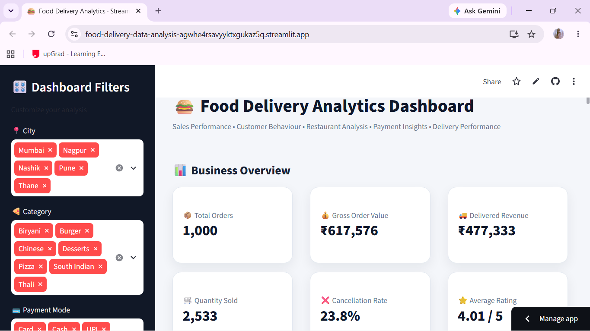

# 🍔 Food Delivery Data Analysis Dashboard

An interactive, data-driven Streamlit dashboard designed to analyze food delivery operations, sales performance, customer preferences, and order metrics.



---

## 📌 Project Overview
This project provides actionable business insights into food delivery trends. It enables stakeholders to monitor key revenue drivers, customer spending behavior, order cancellation rates, and location-wise performance in real time.

---

## 🔥 Key Features & Insights
* **Business Performance KPIs:** Instant tracking of Total Orders, Gross Order Value, Delivered Revenue, and Average Ratings.
* **Interactive Filters:** Dynamic sidebar filters by **City**, **Category** (e.g., Biryani, Pizza, Burger), and **Payment Mode**.
* **Order & Revenue Analysis:** Visual breakdown of sales performance across different cities and food categories.
* **Operational Metrics:** Deep dive into cancellation rates and delivery performance.

---

## 🛠️ Tech Stack
* **Python 3.x**
* **Streamlit** (Interactive UI & Deployment)
* **Pandas** (Data Manipulation & Aggregation)
* **Plotly / Matplotlib** (Data Visualization)

---

## 📁 Repository Structure
```text
food_delivery_analysis/
│── data/                   # Dataset files (CSV/Excel)
│── images/                 # Project screenshots & media
│   └── dashboard.png       # Live dashboard screenshot
│── .gitignore              # Files ignored by Git
│── README.md               # Project documentation
│── app.py                  # Main Streamlit application
└── requirements.txt        # Python dependencies